  

  
  
  
  
  
  
  
  
  

  
  

---

### 👋 Oi! Eu sou o Luis

Eu pego jogos que ficaram presos num console — **Xbox 360, NVIDIA SHIELD, placas de arcade da Namco** — e faço eles rodarem **nativos** em PC e celular Android.

Não é emulação de CPU: o código do jogo é traduzido (PowerPC ou ARM32) para C/C++ e compilado de novo para **x86-64** ou **ARM64**, com um runtime que substitui o sistema original — kernel, GPU, áudio, entrada.

- 🔁 **Recompilação estática** — PowerPC → C++ (rexglue / XenonRecomp) e ARM32 → ARM64
- 🎮 **GPU** — tradução do Xenos (PM4) para Direct3D 12 e Vulkan, shaders DX9 → GLSL
- 📱 **Android** — NDK, Vulkan em Adreno e Mali, controles por toque, APKs autossuficientes
- 🕹️ **Emulação de arcade** — Namco System 246/256 no Android
- 🖥️ **Front-ends** — launchers no estilo de console para PPSSPP e PCSX2

> ⚠️ Nenhum projeto meu inclui arquivos de jogo. Você sempre precisa da **sua própria cópia**.

---

### 🚀 Projetos em destaque

<table>
  <tr>
    <td width="50%" valign="top">
      <h4>⚽ <a href="https://github.com/luisxl15/Strikers-Android-Port">Super Mario Strikers — Android</a></h4>
      Super Mario Strikers rodando nativo em arm64, com o mesmo renderizador do port de PC desenhando via Vulkan.  
      
      
      
    </td>
    <td width="50%" valign="top">
      <h4>🚓 <a href="https://github.com/luisxl15/GTA-IV-RECOMP-XBOX-360">GTA IV — Recomp do Xbox 360</a></h4>
      Recompilação estática do GTA IV do 360 para x86-64: ~36 mil funções traduzidas, chega ao gameplay. Experimental.  
      
      
      
    </td>
  </tr>
  <tr>
    <td width="50%" valign="top">
      <h4>🎸 <a href="https://github.com/luisxl15/Guitar-Hero-3-Recomp-">Guitar Hero III — Recomp</a></h4>
      Guitar Hero III: Legends of Rock do 360 recompilado para PC e Android, com launcher que instala a partir do seu disco.  
      
      
    </td>
    <td width="50%" valign="top">
      <h4>🏎️ <a href="https://github.com/luisxl15/Midnight-Club-L.A-RECOMP">Midnight Club: Los Angeles — Recomp</a></h4>
      Midnight Club: LA do 360 traduzido para C++ e compilado nativo para x64, com Xenos → Direct3D 12.  
      
      
    </td>
  </tr>
  <tr>
    <td width="50%" valign="top">
      <h4>🐍 <a href="https://github.com/luisxl15/METAL-GEAR-SOLID-2-Sons-of-Liberty-for-Android">Metal Gear Solid 2 HD — Android ARM64</a></h4>
      A versão do SHIELD (ARM32) recompilada para ARM64 — roda nos Snapdragon e Dimensity que não executam mais 32 bits. Adreno e Mali, 7 idiomas.  
      
      
    </td>
    <td width="50%" valign="top">
      <h4>🛹 <a href="https://github.com/luisxl15/SKATE-3-ANDROID-PORT">Skate 3 — Android</a></h4>
      Port arm64 do Skate 3 Recompiled: Vulkan, SDL3, controles por toque e gameplay funcionando.  
      
      
    </td>
  </tr>
  <tr>
    <td width="50%" valign="top">
      <h4>🕹️ <a href="https://github.com/luisxl15/NAMCO-2x6-ANDROID-EMU">Namco System 246/256 EMU</a></h4>
      Emulador Android das placas de arcade da Namco (Tekken 4/5, Soulcalibur, Time Crisis, Taiko…) com JVS, SRAM e recompiladores ARM64.  
      
      
    </td>
    <td width="50%" valign="top">
      <h4>🧟 <a href="https://github.com/luisxl15/Resident-Evil-5-Android-PORT">Resident Evil 5 — Android</a></h4>
      Resident Evil 5 rodando no Android. Em andamento.  
      
      
    </td>
  </tr>
</table>

<b>Mais projetos</b>

 

| Projeto | O que é |
|---|---|
| [BETTER-SIMPSONS-HIT-AND-RUN-ANDROID-PORT](https://github.com/luisxl15/BETTER-SIMPSONS-HIT-AND-RUN-ANDROID-PORT) | The Simpsons: Hit & Run no Android (baseado no trabalho de ZenoArrows e Carlox33) |
| [AdrenalineLauncher](https://github.com/luisxl15/AdrenalineLauncher) | Front-end estilo XMB para o PPSSPP: capas, conquistas, pacotes de textura HD, compressão CHD/CSO |
| [EmotionLauncher](https://github.com/luisxl15/EmotionLauncher) | Launcher para o PCSX2 com cara de console |
| [Namco-System-246-Widescreen__Patches](https://github.com/luisxl15/Namco-System-246-Widescreen__Patches) | Patches widescreen para o emulador de System 246 |
| [Ubuntu-24.02-Noble-For-Orange-Pi-s](https://github.com/luisxl15/Ubuntu-24.02-Noble-For-Orange-Pi-s) | Imagem Ubuntu limpa, feita do zero, para Orange Pi |

---

🇺🇸 <b>English</b>

 

Hi, I'm Luis, from Brazil. I take games that are stuck on one console (**Xbox 360, NVIDIA SHIELD, Namco arcade boards**) and make them run **natively** on PC and Android phones.

It isn't CPU emulation. The game's code (PowerPC or ARM32) is translated to C/C++ and compiled again for **x86-64** or **ARM64**, on top of a runtime that stands in for the original system: kernel, GPU, audio and input.

- **Static recompilation**: PowerPC → C++ (rexglue / XenonRecomp), ARM32 → ARM64
- **GPU**: Xenos (PM4) → Direct3D 12 / Vulkan, DX9 shaders → GLSL
- **Android**: NDK, Vulkan on Adreno and Mali, touch controls, self-contained APKs
- **Arcade emulation**: Namco System 246/256 on Android

None of my projects ship game files. You always need **your own copy** of the game.

